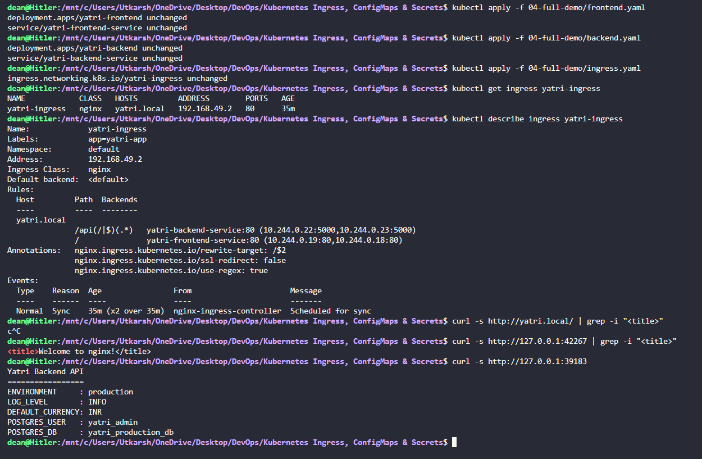

# Kubernetes Ingress, ConfigMaps & Secrets

**Utkarsh Raj 24BCS10318**

## Task 1: Non-Sensitive Configuration Decoupling via ConfigMaps

* Decouple environment-specific runtime configurations (log levels, ports, currency settings) from container images by storing them in a declarative `ConfigMap`.

* **Commands:**
    ```bash
    kubectl apply -f 01-configmap/app-config.yaml
    kubectl get configmap yatri-app-config
    kubectl describe configmap yatri-app-config
    kubectl get configmap yatri-app-config -o jsonpath='{.data.ENVIRONMENT}' && echo ""
    kubectl get configmap yatri-app-config -o jsonpath='{.data.LOG_LEVEL}' && echo ""
    ```

* **Output:**

    

---

## Task 2: ConfigMap Live Update & Pod Immobility Verification Drill

* Demonstrate that updating a `ConfigMap` does not retroactively update environment variables inside active running containers, and use `kubectl rollout restart` to trigger a zero-downtime rolling update.

* **Commands:**
    ```bash
    # Step 1: Patch ConfigMap live
    kubectl patch configmap yatri-app-config --type merge -p '{"data":{"ENVIRONMENT":"staging"}}'

    # Step 2: Check running pod env (assuming backend pod from 04-full-demo is running)
    kubectl exec -it deploy/yatri-backend -- env | grep ENVIRONMENT

    # Step 3: Trigger rolling restart
    kubectl rollout restart deployment/yatri-backend
    kubectl rollout status deployment/yatri-backend

    # Step 4: Re-check pod env
    kubectl exec -it deploy/yatri-backend -- env | grep ENVIRONMENT

    # Step 5: Revert patch for subsequent labs
    kubectl patch configmap yatri-app-config --type merge -p '{"data":{"ENVIRONMENT":"production"}}'
    kubectl rollout restart deployment/yatri-backend
    ```

* **Output:**

    

---

## Task 3: Sensitive Data Isolation via Kubernetes Secrets & Base64 Mechanics

* Implement credential isolation using an `Opaque` Kubernetes `Secret`, illustrating that Base64 is merely an encoding scheme (not encryption) that can be decoded on the CLI.

* **Commands:**
    ```bash
    kubectl apply -f 02-secret/db-secret.yaml
    kubectl get secret yatri-db-secret
    kubectl describe secret yatri-db-secret
    kubectl get secret yatri-db-secret -o jsonpath='{.data.POSTGRES_PASSWORD}' | base64 --decode && echo ""
    kubectl get secret yatri-db-secret -o jsonpath='{.data.POSTGRES_USER}' | base64 --decode && echo ""
    ```

* **Output:**

    

---

## Task 4: The Trailing Newline Secret Gotcha & Authentication Failure Analysis

* Analyze the common authentication bug where encoding with standard `echo` appends an invisible ASCII newline (`\n` / `0x0A`), corrupting passwords sent to backend databases.

* **Commands:**
    ```bash
    # Broken pattern: appends 0x0a (\n)
    echo "secretpassword" | xxd
    echo "secretpassword" | base64

    # Correct pattern: exact byte stream
    echo -n "secretpassword" | xxd
    echo -n "secretpassword" | base64

    # Visual comparison
    echo "Wrong (with newline): $(echo "secretpassword" | base64)"
    echo "Right (no newline):   $(echo -n "secretpassword" | base64)"
    ```

* **Output:**

    

---

## Task 5: Combined ConfigMap and Secret Pod Injection Architecture

* Deploy a backend pod that simultaneously consumes configuration from both a `ConfigMap` and a `Secret`, verifying that both sources merge cleanly into the container's environment.

* **Commands:**
    ```bash
    kubectl apply -f 04-full-demo/configmap.yaml
    kubectl apply -f 04-full-demo/secret.yaml
    kubectl apply -f 04-full-demo/backend.yaml
    kubectl rollout status deployment/yatri-backend

    # Verify injection inside pod
    kubectl exec -it deploy/yatri-backend -- env | grep -E "ENVIRONMENT|LOG_LEVEL|POSTGRES|DEFAULT_CURRENCY"
    ```

* **Output:**

    

---

## Task 6: Architectural Comparative Study — Ingress Resource vs. Ingress Controller

* Provide a conceptual and technical breakdown of the division of responsibilities between an `Ingress` rule manifest and an `Ingress Controller`.

* **Commands:**
    ```bash
    # Show that Ingress API exists natively
    kubectl api-resources | grep -i ingress
    ```

* **Output:**

    

---

## Task 7: NGINX Ingress Controller Activation & Lifecycle Verification

* Enable and verify the NGINX Ingress Controller daemon on Minikube, validating the pod lifecycle within the `ingress-nginx` namespace.

* **Commands:**
    ```bash
    minikube addons enable ingress
    kubectl get pods -n ingress-nginx
    kubectl wait --namespace ingress-nginx \
    --for=condition=ready pod \
    --selector=app.kubernetes.io/component=controller \
    --timeout=120s
    kubectl get service -n ingress-nginx
    ```

* **Output:**

    

---

## Task 8: Local DNS Resolution & System Hosts File Mapping

* Configure host-level local DNS name resolution by binding the Minikube VM/Docker IP to the custom domain `yatri.local` in `/etc/hosts`.

* **Commands:**
    ```bash
    MINIKUBE_IP=$(minikube ip)
    echo "Minikube IP is: ${MINIKUBE_IP}"

    # Append to /etc/hosts if not already present
    if ! grep -q "yatri.local" /etc/hosts; then
    echo "${MINIKUBE_IP}  yatri.local" | sudo tee -a /etc/hosts
    fi

    # Verify entry
    grep "yatri.local" /etc/hosts
    ```

* **Output:**

    

---

## Task 9: Layer 7 Path-Based Routing Implementation

* Implement path-based Layer 7 traffic routing using an Ingress resource, directing `/` to the frontend Nginx service and `/api/*` to the backend Python API service.

* **Commands:**
    ```bash
    kubectl apply -f 04-full-demo/frontend.yaml
    kubectl apply -f 04-full-demo/backend.yaml
    kubectl apply -f 04-full-demo/ingress.yaml

    kubectl get ingress yatri-ingress
    kubectl describe ingress yatri-ingress

    # Test Frontend path (Root /)
    curl -s <http://yatri.local/> | grep -i "<title>"

    # Test Backend path (/api/)
    curl -s <http://yatri.local/api/>
    ```

* **Output:**

    

---

## Task 10: Virtual Host-Based Routing (Subdomain Routing)

* Deploy an Ingress configuration that routes incoming requests based on virtual hostnames (`portal.campus.local` vs. `api.campus.local`) targeting the same external IP.

* **Commands:**
    ```bash
    MINIKUBE_IP=$(minikube ip)
    echo "${MINIKUBE_IP}  portal.campus.local api.campus.local" | sudo tee -a /etc/hosts

    # Verify routing by Host Header
    curl -s -H "Host: portal.campus.local" <http://$>{MINIKUBE_IP}/ | grep -i "<title>"
    curl -s -H "Host: api.campus.local" <http://$>{MINIKUBE_IP}/api/
    ```

* **Output:**

    

---

## Task 11: Hybrid Ingress Routing Architecture

* Construct and validate an Ingress resource that merges both multi-tenant virtual host routing and path-based routing in a single configuration.

* **Commands:**
    ```bash
    kubectl apply -f 03-ingress/ingress-tls.yaml
    kubectl get ingress campus-ingress-tls
    kubectl describe ingress campus-ingress-tls
    ```

* **Output:**

    

---

## Task 12: Ingress TLS/HTTPS Termination & Secret Binding

* Configure SSL/TLS termination on an Ingress by generating a self-signed certificate, creating a `kubernetes.io/tls` secret, and serving traffic securely over HTTPS port `443`.

* **Commands:**
    ```bash
    # Step 1: Generate TLS Keypair
    openssl req -x509 -nodes -days 365 -newkey rsa:2048 \
    -keyout tls.key \
    -out tls.crt \
    -subj "/CN=campus.local/O=CampusDevOps"

    # Step 2: Store in Kubernetes Secret
    kubectl create secret tls campus-tls-cert --cert=tls.crt --key=tls.key
    kubectl get secret campus-tls-cert

    # Step 3: Apply TLS Ingress
    kubectl apply -f 03-ingress/ingress-tls.yaml
    kubectl get ingress campus-ingress-tls

    # Step 4: Verify HTTPS handshake over port 443
    INGRESS_IP=$(minikube ip)
    curl -k -v --resolve portal.campus.local:443:${INGRESS_IP} <https://portal.campus.local/> 2>&1 | grep -E "Server certificate|HTTP/|SSL connection"
    ```

* **Output:**

    

---

## Task 13: End-to-End Multi-Tier Microservice Integration & Automation Scripting

* Execute the comprehensive full-lifecycle automation scripts (`run-demo.sh` and `cleanup.sh`), analyzing multi-document YAML manifests (`--`) and verifying complete infrastructure cleanup.

* **Commands:**
    ```bash
    # Execute full automated deployment
    bash 04-full-demo/run-demo.sh

    # Audit entire stack state
    kubectl get configmap,secret,ingress,deploy,svc,pods -l app=yatri-app

    # Execute automated teardown
    bash 04-full-demo/cleanup.sh

    # Confirm clean state
    kubectl get ingress yatri-ingress || echo "Ingress deleted"
    kubectl get deployment yatri-backend yatri-frontend || echo "Deployments deleted"
    ```

* **Output:**

    